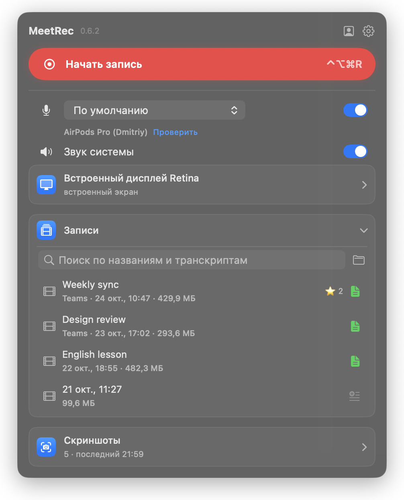
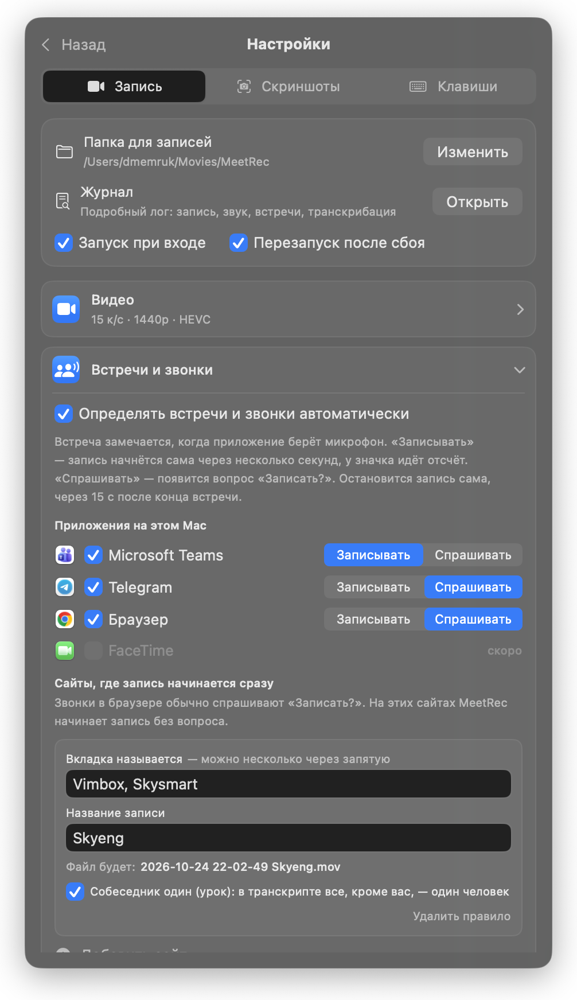
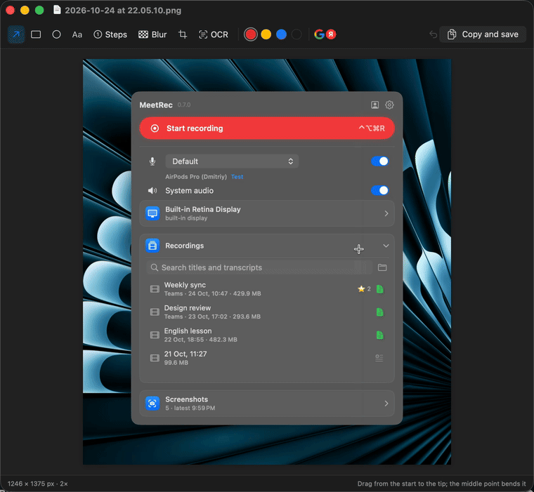
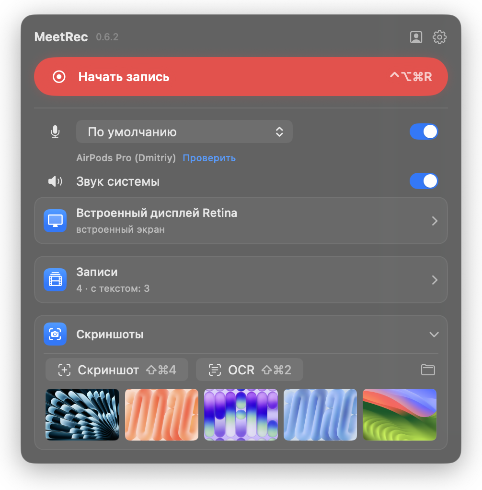
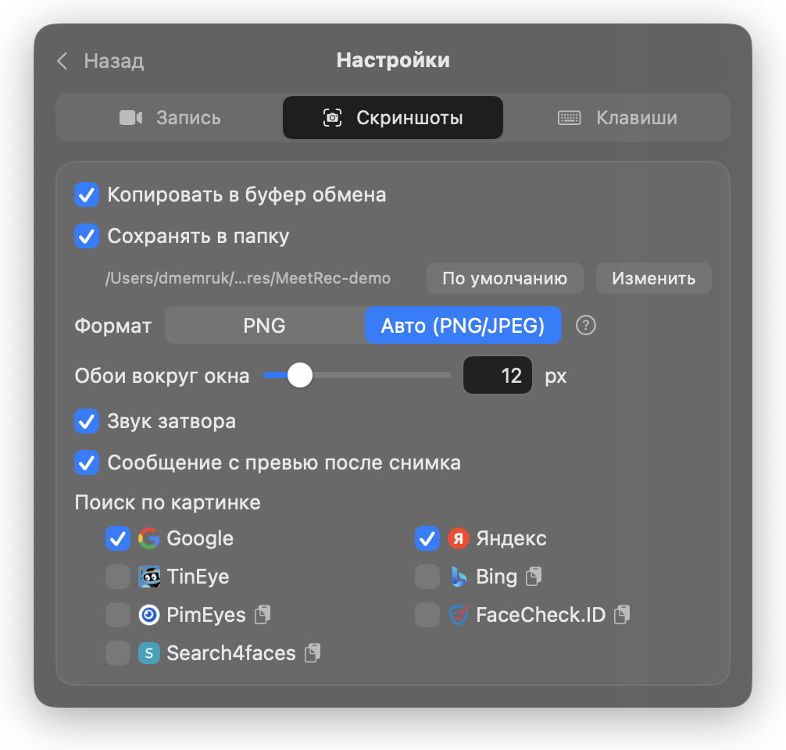
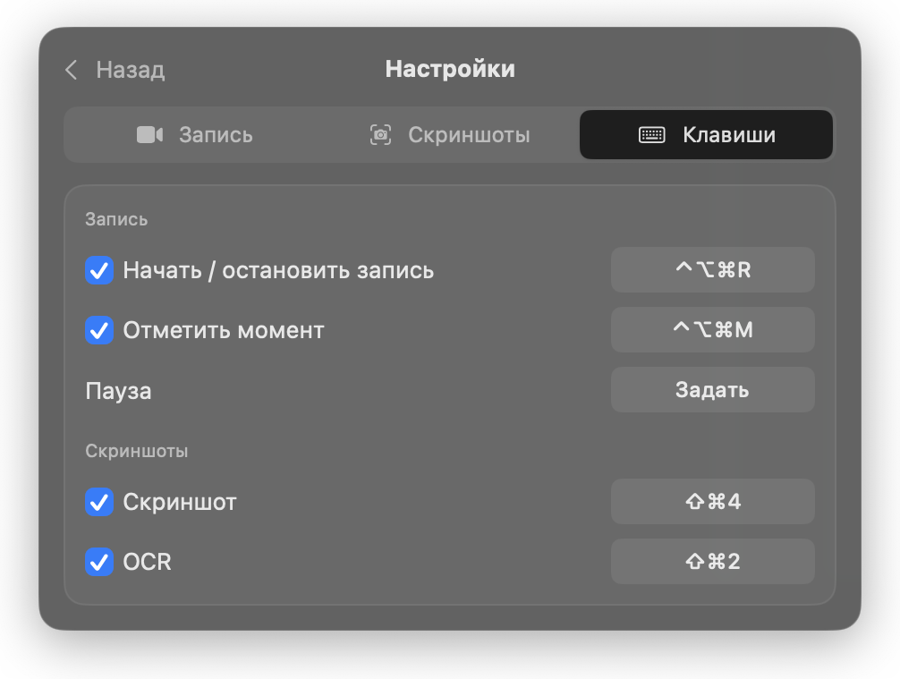

# MeetRec

A small native macOS menu bar app that records meetings (screen, microphone and the other side's
audio), transcribes them locally and takes Shottr-style screenshots. Written to replace OBS, which
was only ever used for "Start Recording" in calls.

**The interface is in Russian.** English localization may come later; pull requests are welcome.

[Русская версия ниже](#по-русски)

<p align="center">
  
  
</p>

<p align="center">
  
</p>

## Features

- **One click or ⌃⌥⌘R** to record the screen, microphone and system audio into a crash-safe
  fragmented `.mov` (separate tracks plus a mixed one; ~0.5 GB/hour at 1440p HEVC).
- **Automatic meeting recording**: starts when Microsoft Teams takes the microphone and stops when
  it lets go; calls in browsers and Telegram ask first; browser tab rules record known calls
  without asking.
- **Live status**: level meters for both sides, ⚠️ in the menu bar when a source goes silent, disk
  space guard, crash watchdog.
- **Markers, pause and chapters**: ⭐ markers become chapters in the video and lines in the
  transcript; pause works like in OBS.
- **Local transcription** with speaker names (mlx-whisper + pyannote, nothing leaves the Mac):
  your own speech is found through the microphone track, other voices are recognised from enrolled
  samples.
- **Screenshots** (⇧⌘4) with a frozen screen, window shots on wallpaper, an annotation editor
  (arrows, boxes, steps, blur, crop), OCR (⇧⌘2) and reverse image search.
- Window recording, display picker with live thumbnails, a recording island at the notch, a camera
  mirror to check yourself before a call.

<details>
<summary>More screenshots</summary>

<p align="center">
  
  
  
</p>
</details>

## Requirements

- macOS 15 or later, Apple Silicon (transcription uses MLX).
- Xcode and [XcodeGen](https://github.com/yonaskolb/XcodeGen) (`brew install xcodegen`).
- For transcription: [uv](https://docs.astral.sh/uv/) (`brew install uv`) and a Hugging Face
  account (below).

## Build and install

```bash
git clone https://github.com/ProteinR/MeetRec.git
cd MeetRec
./scripts/install.sh
```

This builds a Release copy, signs it, installs it to `~/Applications/MeetRec.app` and starts it.
On first start macOS asks for Screen Recording and Microphone access; start MeetRec again after
granting Screen Recording.

### Signing (keeps permissions across rebuilds)

There are no signed binary releases (no Apple Developer account). Without a stable signature every
rebuild looks like a new app to macOS and the permissions have to be granted again. To avoid that,
create a self-signed code signing certificate once:

1. Keychain Access → Certificate Assistant → Create a Certificate…
2. Name: `MeetRec Local Code Signing`, Identity Type: Self-Signed Root, Certificate Type: Code
   Signing.

`install.sh` finds it by that name (or set `MEETREC_SIGN_IDENTITY` to another one). Without it the
app is ad-hoc signed and still works.

If permissions get stuck (granted but the app keeps asking):

```bash
tccutil reset ScreenCapture com.dmemruk.MeetRec
tccutil reset Microphone com.dmemruk.MeetRec
```

### Transcription setup

1. Accept the conditions of
   [pyannote/speaker-diarization-community-1](https://huggingface.co/pyannote/speaker-diarization-community-1)
   on Hugging Face.
2. Log in once in the terminal: `uvx --from huggingface_hub hf auth login` (stores the token in `~/.cache/huggingface`).
3. In MeetRec: settings → Запись → Транскрибация → «Скачать модели» (~2 GB, once).

Everything then runs locally at background priority.

## Configuring with scripts or AI agents

All settings are user defaults; [SETTINGS.md](SETTINGS.md) lists every key, its values and the
JSON formats (browser rules, transcript copy rules, shortcuts), so an agent can set MeetRec up with
`defaults write`. [AGENTS.md](AGENTS.md) describes how the app works for agents changing the code.

## Tests

```bash
xcodegen generate
xcodebuild test -project MeetRec.xcodeproj -scheme MeetRec -destination 'platform=macOS' -derivedDataPath build/dd-test
python3 -m unittest discover -s Tests
```

## Notes

- Image search buttons use the services' public upload pages (no official APIs) and may break
  when a site changes. Only Google Lens is on by default; others can be turned on in settings.
- Recording other people may require their consent where you live. MeetRec does not notify
  participants.

## License

[MIT](LICENSE)

---

## По-русски

MeetRec — маленькое нативное приложение в строке меню macOS: записывает встречи (экран,
микрофон и звук собеседников), локально делает транскрипт с именами спикеров и снимает скриншоты
как Shottr. Сделано вместо OBS, в котором нужна была только кнопка «Начать запись».

- Сборка и установка: `./scripts/install.sh` (нужны Xcode и XcodeGen, macOS 15+, Apple Silicon).
- Чтобы разрешения на запись экрана и микрофон не сбрасывались после каждой пересборки, создайте
  один раз самоподписанный сертификат для подписи кода «MeetRec Local Code Signing» (Связка
  ключей → Ассистент сертификации → Создать сертификат…, тип «Подпись кода»).
- Транскрибация: `uv`, аккаунт Hugging Face с принятыми условиями модели pyannote,
  `uvx --from huggingface_hub hf auth login`, затем «Скачать модели» в настройках.
- Все настройки можно менять из терминала или агентом: [SETTINGS.md](SETTINGS.md).
- Лицензия MIT.
